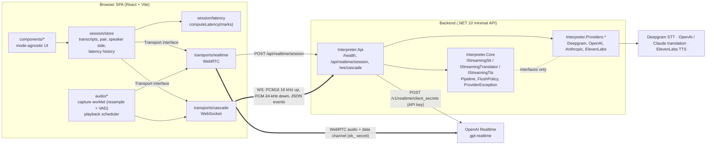
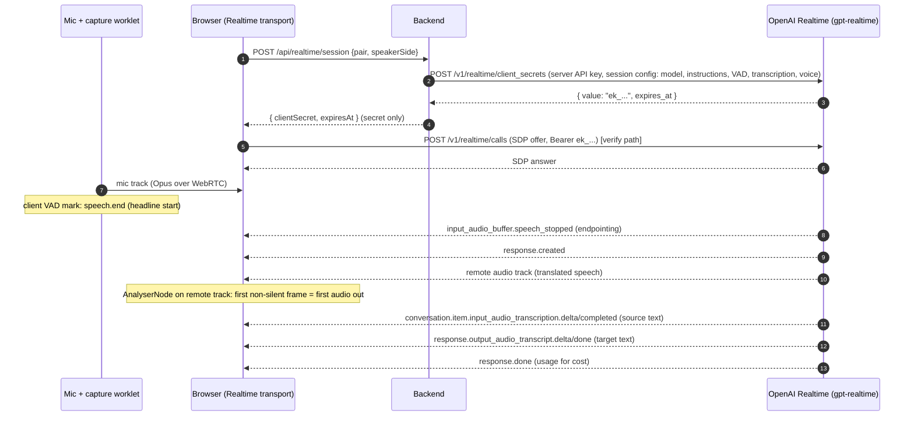
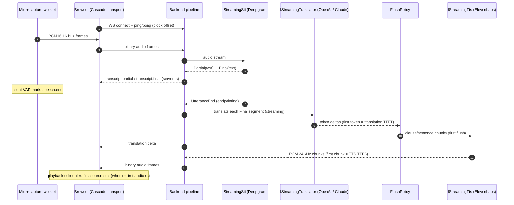

# Architecture

Two transports behind one interface, one mode-agnostic UI and session store. The browser never holds a vendor API key.

## Components



Rules enforced by tooling (see [ACCEPTANCE.md](ACCEPTANCE.md)):
- `web/src/components/**` may not import `web/src/transports/*/**` internals (ESLint `no-restricted-imports`).
- `Interpreter.Core` may not reference any `Interpreter.Providers.*` assembly (architecture test).
- Vendor SDK/HTTP/WS code lives only in `Interpreter.Providers.*`.

## Transport interface (web)

```ts
interface Transport {
  start(config: SessionConfig): Promise<void>;   // mic stream, pair, speaker side, input source
  stop(): Promise<void>;                          // closes peer/WS, disconnects nodes, stops worklets
  readonly events: EventTarget;                   // transcript.partial|final, translation.delta|final,
                                                  // latency.mark, error, state
}
```

The store owns transcript history, so a mid-session toggle is `await current.stop(); await next.start(config)` plus a "switched to X" marker (D12).

## Realtime data path



Event names checked against the `openai` npm package v7.32.0 type definitions on 2026-10-14. The WebRTC SDP path is checked live in T1.5.

## Cascade data path



Internals: `System.Threading.Channels` with bounded capacity between stages (back-pressure), one linked `CancellationToken` per session so teardown cancels every stage, and every adapter throws only `ProviderException { Kind, RetryAfter }` (D8).

## Latency mark points (D9)

All marks are on the client clock (`performance.now()`); server timestamps are converted with a ping/pong offset (min-RTT sample, re-estimated every 30 s).

| Mark | Realtime | Cascade |
|---|---|---|
| `speech.end` (headline start) | client energy VAD, back-dated to last voiced frame | same code |
| `endpoint` | `input_audio_buffer.speech_stopped` | STT `UtteranceEnd` / endpoint final |
| `stt.final` | n/a (transcription runs on a separate model) | STT final for the utterance |
| `translation.first_token` | opaque | translator first delta |
| `tts.first_flush` | opaque | FlushPolicy first emit |
| `tts.first_byte` | opaque | first TTS audio chunk at server |
| `response.created` | data channel event | n/a |
| `audio.first_out` (headline end) | first non-silent frame on remote track | first chunk `source.start(when)` |

Realtime shows endpointing → `response.created` → first audio, and labels model-internal time as opaque. Cascade shows all six stages. `AudioContext.outputLatency` is reported alongside, because "heard" (Realtime probe) and "scheduled" (cascade) differ by output latency.

## Audio

- Capture: `getUserMedia({ echoCancellation, noiseSuppression, autoGainControl })` at the context's native rate; the worklet downsamples to 16 kHz PCM16 for cascade and runs the client VAD for both modes.
- Playback (cascade): scheduler with a cursor and a 3 s cap on queued audio; overflow drops the oldest unplayed chunk and logs `drift.skip` (D14).
- Echo: half-duplex mic gating while output plays, 150 ms tail (D13). Headphones recommended.
- Teardown on stop: close peer and sockets, disconnect nodes, terminate worklet ports, revoke object URLs.
