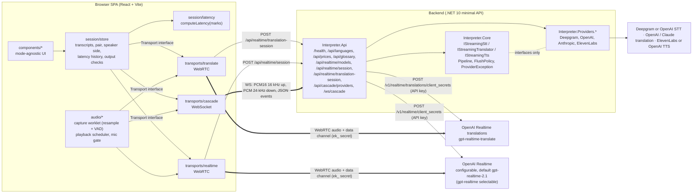

# Architecture

Three transports behind one interface, one mode-agnostic UI and session store. The browser never holds a vendor API key.

The modes (`web/src/transports/index.ts`, `createTransport(mode)`):
- **Realtime translate** (`translate`): `gpt-realtime-translate` over WebRTC, a session that takes only a target language (G17; the default for EN↔ES, `realtimeTranslate` in `config/languages.json`).
- **Realtime** (`realtime`): the OpenAI Realtime API over WebRTC, instructed to interpret. The model is configuration (`OpenAI:Realtime:Model`), default `gpt-realtime-2.1`; the brief's `gpt-realtime` is on the allow-list and selectable in the setup screen (G1, README "Known constraints").
- **Cascade** (`cascade`): a WebSocket to our backend, which runs STT → translation → TTS as a streaming pipeline with swappable providers.

## Components



Every session needs the demo access token (`X-Access-Token`, checked server-side in constant time) and the mint endpoints and the cascade upgrade are rate-limited per client address (G2). Ephemeral secrets live 60 s and a session is capped at 30 minutes in every mode (G19).

BAA mode (`Compliance:RequireBaa`, off by default; README "BAA mode", DECISIONS D18) makes the Realtime mint, the translation mint and the cascade socket refuse any route that is not on its vendor's HIPAA-eligible list or whose vendor has no BAA declared in `Compliance:BaaSigned`, before any audio or text is sent; `/api/languages` returns the blocked modes and the setup screen disables them with the reason. The eligibility table is `BaaRoutes` in `server/Interpreter.Api/Security/Compliance.cs`. Cascade passes only as OpenAI STT + Claude translator + OpenAI TTS (`Cascade:Tts=openai`, `/v1/audio/speech`).

Rules enforced by tooling (see [ACCEPTANCE.md](ACCEPTANCE.md)):
- `web/src/components/**` may not import a concrete transport: ESLint `no-restricted-imports` in `web/eslint.config.js` blocks `transports/*` and `transports/*/**` and allows only `transports/types` and `transports/index` (widened from `{realtime,cascade}` in 42fba49). Components import only `transports/types`.
- `Interpreter.Core` may not reference any `Interpreter.Providers.*` assembly (`DependencyRulesTests`, reflection).
- Vendor SDK/HTTP/WS code lives only in `Interpreter.Providers.*`.

## Transport interface (web)

As built, from `web/src/transports/types.ts`:

```ts
/** 'translate' is gpt-realtime-translate (G17): simultaneous, configured by target language only. */
export type Mode = 'translate' | 'realtime' | 'cascade'
export type SpeakerSide = 'A' | 'B'

export interface SessionConfig {
  /** Language spoken by side A and side B, e.g. en / es. */
  langA: string
  langB: string
  speaker: SpeakerSide
  /** Realtime model id from the server's allowed list; the server default when absent. */
  realtimeModel?: string
  /** Use the configured glossary (T3.7): STT keyterms and fixed term translations, same terms in both modes. */
  glossary?: boolean
  /** Replay harness input; the mic is used when absent. */
  inputStream?: MediaStream
  /**
   * Finished turns from before this connection (G9): a mode switch or a cascade speaker switch starts a
   * new connection, and these are sent along as context data so the new one keeps names and register.
   * Read at connect time; the newest last.
   */
  history?: () => HistoryPair[]
}

export type TransportEvent =
  | { type: 'state'; state: 'connecting' | 'live' | 'closed' }
  | { type: 'transcript'; role: 'source' | 'target'; utteranceId: string; text: string; final: boolean; confidence?: number }
  | { type: 'mark'; name: MarkName; t: number; utteranceId?: string }
  | { type: 'usage'; utteranceId?: string; usage: Usage }
  | { type: 'error'; kind: ErrorKind; message: string; retryAfterMs?: number; utteranceId?: string }
  /** Something the user should know that needs no action (a retry in progress, dropped late audio). */
  | { type: 'notice'; message: string; utteranceId?: string }
  | { type: 'level'; rms: number }
  | { type: 'gated'; gated: boolean }

export type TransportListener = (e: TransportEvent) => void

export interface Transport {
  readonly mode: Mode
  start(config: SessionConfig): Promise<void>
  /** Closes every peer, socket, node and worklet this transport opened. Safe to call twice. */
  stop(): Promise<void>
  setSpeaker(side: SpeakerSide): void
  subscribe(listener: TransportListener): () => void
}
```

The store owns transcript history, so a mid-session toggle is `await current.stop(); await next.start(config)` plus a "switched to X" marker (D12). The new connection receives the last 6 finished turns as context data through `config.history` (G9); Realtime translate has no context input, so a switch into it starts with no memory of the conversation and the marker says so.

## Realtime data path

```mermaid
sequenceDiagram
  autonumber
  participant Mic as Mic + capture worklet
  participant B as Browser (Realtime transport)
  participant S as Backend
  participant O as OpenAI Realtime (default gpt-realtime-2.1)
  B->>S: POST /api/realtime/session {source, target, model?, glossary?} + X-Access-Token
  S->>O: POST /v1/realtime/client_secrets (server API key; session: model, instructions, turn_detection null (client endpointing, server VAD only with Endpointing=server), input transcription, voice; expires_after 60 s)
  O-->>S: { value: "ek_...", expires_at, session }
  S-->>B: { clientSecret, expiresAt, model, transcriptionModel, callsUrl, instructions for both directions }
  B->>O: POST /v1/realtime/calls (SDP offer, Bearer ek_..., application/sdp)
  O-->>B: 201, SDP answer (Location: /v1/realtime/calls/rtc_...)
  Mic->>B: mic track (Opus over WebRTC)
  Note over Mic: client VAD mark: speech.end (headline start)
  B->>O: input_audio_buffer.commit + response.create, 300 ms after speech.end (client endpointing)
  O-->>B: input_audio_buffer.committed (endpoint)
  O-->>B: response.created
  O-->>B: remote audio track (translated speech)
  Note over B: AnalyserNode on remote track: first non-silent frame = audio.first_out
  O-->>B: conversation.item.input_audio_transcription.delta/completed (source text, separate ASR)
  O-->>B: response.output_audio_transcript.delta/done (target text)
  O-->>B: response.done (usage for cost)
  B->>O: session.update (other direction's instructions) on a speaker flip
```

Verified on 2026-10-14 (T1.5, [DECISIONS.md](DECISIONS.md) D4): `POST /v1/realtime/client_secrets` returned `{ value: "ek_…", expires_at, session }`, and the SDP offer to `POST /v1/realtime/calls` with `Authorization: Bearer ek_…` returned `201` with the answer and a `Location: /v1/realtime/calls/rtc_…` header, from headless Chromium. ICE never connected from the cloud container (media ports blocked), so I checked the audio path by ear on a local run and, later, by the soaks on the GitLab runner. Event and session field names were checked against the `openai` npm package's type definitions (v7.32.0 on 2026-10-14; `web/src/transports/realtime/events.ts`); the package is consulted for its types only and is not a dependency of the app.

## Realtime translate data path

```mermaid
sequenceDiagram
  autonumber
  participant Mic as Mic + capture worklet
  participant B as Browser (translate transport)
  participant S as Backend
  participant O as OpenAI Realtime translations (gpt-realtime-translate)
  B->>S: POST /api/realtime/translation-session {target} + X-Access-Token
  S->>O: POST /v1/realtime/translations/client_secrets (server API key; session: model, audio.output.language, input transcription gpt-realtime-whisper; no instructions, no tools; expires_after 60 s)
  O-->>S: { value: "ek_...", expires_at, session }
  S-->>B: { clientSecret, expiresAt, model, callsUrl, target }
  B->>O: POST /v1/realtime/translations/calls (SDP offer, Bearer ek_...)
  O-->>B: 201, SDP answer
  Mic->>B: mic track (never gated: the model speaks while the speaker talks)
  Note over Mic: client VAD marks: speech.start, speech.end
  O-->>B: session.input_transcript.delta (source text, elapsed_ms)
  O-->>B: session.output_transcript.delta (translated text, elapsed_ms)
  Note over B: segmenter pairs each translated sentence with the source sentence that had started when it began; marks source.first_text, target.first_text
  O-->>B: remote audio track → audio.first_out (first non-silent frame)
  B->>O: session.update {audio.output.language} on a speaker flip
```

Verified on 2026-10-14 (G17): the mint and the SDP exchange with `/v1/realtime/translations/calls` returned 201 with a data channel offered. The data-channel event names were confirmed by the runner soak (`eval/results/soak-2026-10-14-translate-synthetic.json`). Latency for this mode is reported as text lag (first source text → first translated text) and start lag (speech start → first audio), because speech end → first audio is often negative for a simultaneous interpreter (README "Known constraints").

## Cascade data path

```mermaid
sequenceDiagram
  autonumber
  participant Mic as Mic + capture worklet
  participant B as Browser (Cascade transport)
  participant P as Backend pipeline
  participant STT as IStreamingStt (Deepgram or OpenAI transcription, default gpt-realtime-whisper)
  participant TR as IStreamingTranslator (OpenAI / Claude)
  participant FP as FlushPolicy
  participant TTS as IStreamingTts (ElevenLabs or OpenAI speech)
  B->>P: WS /ws/cascade, start {token, source, target, translator?, history}; ping/pong (clock offset)
  Note over B,P: speaker flip: B sends direction {source, target}; P finishes the turn in flight, then runs the new direction, carries finished turns, acks direction {source, target, t}. Error frames carry kind, provider, message.
  Mic->>B: PCM16 16 kHz frames
  B->>P: binary audio frames
  P->>STT: audio stream
  STT-->>P: Partial(text) ... Final(text)
  P-->>B: transcript.partial / transcript.final (server ts)
  Note over Mic: client VAD mark: speech.end
  B->>P: commit, 300 ms after speech.end (client endpointing)
  P->>STT: input_audio_buffer.commit (OpenAI: the endpoint mark)
  STT-->>P: Final for the turn (OpenAI) / UtteranceEnd (Deepgram)
  P->>TR: translate each Final segment (streaming, no tools, transcript as delimited data)
  TR-->>FP: token deltas (first token = translation TTFT)
  FP->>TTS: clause/sentence chunks (first flush)
  P-->>B: translation.delta / translation.final
  TTS-->>P: PCM 24 kHz chunks (first chunk = TTS TTFB)
  P-->>B: binary audio frames
  Note over B: playback scheduler: first source.start(when) = audio.first_out
```

Internals: `System.Threading.Channels` with bounded capacity between stages (back-pressure), one linked `CancellationToken` per session so teardown cancels every stage, and every adapter throws only `ProviderException { Kind, RetryAfter }` (D8). A speaker switch is a `direction` message on the same socket: the pipeline finishes the turn in flight, starts the new direction and carries the last 6 turns as context (D5, G9). The cascade OpenAI STT is `gpt-realtime-whisper` by default (`gpt-4o-transcribe` with server endpointing is the fallback); it streams text during speech, but translation starts on the turn's final, after the commit.

## Latency mark points (D9)

All marks are on the client clock (`performance.now()`); server timestamps are converted with a ping/pong offset (min-RTT sample, re-estimated every 30 s).

| Mark | Realtime | Cascade | Realtime translate |
|---|---|---|---|
| `speech.end` (headline start) | client energy VAD, back-dated to last voiced frame | same code | same code (`speech.start` too) |
| `endpoint` | `input_audio_buffer.committed` for the browser's commit (client endpointing; `speech_stopped` in server mode) | the browser's commit reaching the OpenAI STT adapter (client endpointing); Deepgram `UtteranceEnd` / endpoint final | n/a |
| `stt.final` | n/a (transcription runs on a separate model) | STT final for the utterance | n/a |
| `translation.first_token` | opaque | translator first delta | n/a |
| `tts.first_flush` | opaque | FlushPolicy first emit | n/a |
| `tts.first_byte` | opaque | first TTS audio chunk at server | n/a |
| `response.created` | data channel event | n/a | n/a |
| `source.first_text` / `target.first_text` | n/a | n/a | first source / translated text of a line (text lag) |
| `audio.first_out` (headline end) | first non-silent frame on remote track | first chunk `source.start(when)` | first non-silent frame on remote track |

Realtime shows endpointing → `response.created` → first audio, and labels model-internal time as opaque. Cascade shows all six stages plus network and playback buffer. Realtime translate shows start lag and text lag. `AudioContext.outputLatency` is reported alongside, because "heard" (WebRTC probe) and "scheduled" (cascade) differ by output latency. The VAD threshold is shown in the UI (G8).

## Audio

- Capture: `getUserMedia({ echoCancellation, noiseSuppression, autoGainControl })` at the context's native rate; the worklet downsamples to 16 kHz PCM16 for cascade and runs the client VAD for every mode. The replay harness feeds the same worklet from decoded clips.
- Playback (cascade): scheduler with a cursor and a 3 s cap on queued audio; overflow drops the oldest unplayed chunk and logs `drift.skip`, shown as a notice (D14).
- Echo: half-duplex mic gating while output plays, 150 ms tail (D13), in Realtime and Cascade. Realtime translate cannot gate (it speaks while you talk), so headphones are required there and browser echo cancellation is the only defence.
- Teardown on stop: close peer and sockets, disconnect nodes, terminate worklet ports, revoke object URLs (`web/e2e/mode-switch.spec.ts` checks no socket, peer or audio context survives End).
